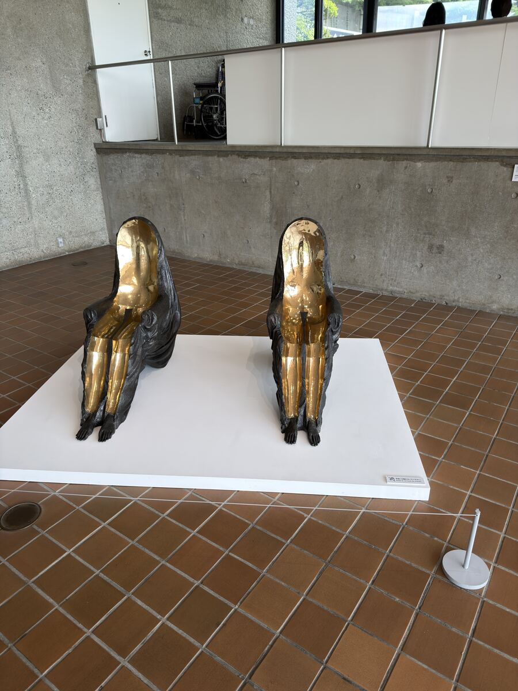

# Hakone-Picasso-Pavilion

箱根毕加索馆（Hakone Picasso Pavilion）的实拍图片仓库，收录参观时拍摄的画作照片。



## 仓库概览

| 项目 | 说明 |
| --- | --- |
| 图片数量 | 148 张 |
| 拍摄时间 | 2026-09-03，10:45–11:55 |
| 拍摄设备 | Apple iPhone 17 Pro Max |
| 拍摄地点 | 约 35.24°N, 139.05°E（箱根一带） |
| 文件格式 | HEIC 145 张、JPG 3 张 |
| 原始分辨率 | HEIC 6048×8064、JPG 1080×1920 |

## 目录结构

```
.
├── README.md
└── images/
    ├── IMG_5455.HEIC ~ IMG_5612.HEIC   # 实拍原图
    ├── IMG_5613.JPG / IMG_5614.JPG     # 实拍原图（JPG）
    ├── IMG_5488.JPG                    # 实拍原图（JPG）
    └── preview.jpg                     # README 展示用缩略图，非原始素材，可删除
```

## 文件命名

图片目前保留相机原始文件名（`IMG_xxxx.HEIC` / `IMG_xxxx.JPG`），按拍摄顺序连续编号，从 `IMG_5455` 到 `IMG_5614`（中间 `IMG_5469`、`IMG_5470` 为视频，未收录）。

若后续需要按画风、题材重命名，建议格式：

```
<编号>-<风格或题材>-<序号>.<扩展名>
```

## 使用说明

- 图片统一平铺在 `images/` 目录下，不新建子目录
- `preview.jpg` 由 `IMG_5455.HEIC` 转换而来，仅用于 README 展示，可随时删除或替换
- HEIC 格式在浏览器和多数代码托管平台的 Markdown 预览中无法直接显示，如需网页展示建议转成 JPG / WebP
